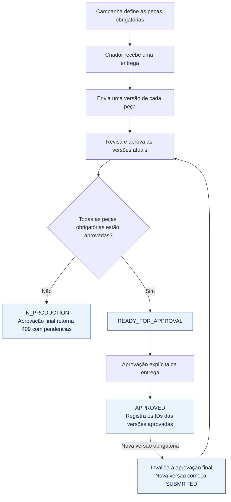

# Revisão de vídeo

[](https://github.com/leonardoperin14/conty-challenge-08-video/actions/workflows/ci.yml)

API para revisar entregas de criadores, com versões de roteiro, vídeo, capa e legenda. Cada campanha define suas peças obrigatórias. A entrega só pode ser aprovada quando a versão atual de cada peça exigida estiver aprovada.

**TypeScript · Node.js 24+ · Hono · SQLite · Vitest**

O envio de conteúdo é representado por uma URL ou nome de arquivo fictício; a API não transfere nem processa arquivos.

## Execução

```bash
npm ci
npm run dev
```

A API inicia em `http://localhost:3000` e usa `data/conty.sqlite`. `PORT` e `DATABASE_PATH` alteram essas configurações.

```bash
npm test
npm run typecheck
npm run build
npm start
```

`npm test` compila o projeto antes de executar a suíte. O CI executa instalação, testes, typecheck e build em Ubuntu com Node.js 24, a cada push ou pull request. Nesta atualização documental, esses comandos não foram executados novamente.

## Fluxo de aprovação



A política está centralizada em [`src/approval-policy.ts`](src/approval-policy.ts). Ela recebe as peças exigidas pela campanha e as versões atuais; não depende de condições fixas como “toda entrega exige roteiro”. O [`DeliveryService`](src/delivery-service.ts) aplica essa política às operações e grava o histórico em transações SQLite.

## Peças exigidas pela campanha

`required_pieces` aceita uma lista sem repetições, com pelo menos um dos tipos:

| Tipo | Peça |
| --- | --- |
| `SCRIPT` | Roteiro |
| `VIDEO` | Vídeo |
| `COVER` | Capa |
| `CAPTION` | Legenda |

**Uma campanha só de vídeo exige apenas `VIDEO`.** Roteiro, capa e legenda só bloqueiam a aprovação se estiverem na lista. Essa configuração é persistida em `campaign_required_pieces` e pode mudar até a criação da primeira entrega; depois disso, alterações retornam `409 / CAMPAIGN_REQUIREMENTS_LOCKED`.

Se faltar uma peça obrigatória ou sua versão atual ainda não estiver aprovada, a aprovação final retorna HTTP `409`, com as pendências:

```json
{
  "error": "REQUIRED_PIECES_NOT_APPROVED",
  "message": "A entrega possui peças obrigatórias pendentes.",
  "pending_pieces": ["VIDEO"]
}
```

## Exemplo: campanha só de vídeo

Crie a campanha e use o `id` retornado no próximo comando:

```bash
curl -X POST http://localhost:3000/campaigns \
  -H 'Content-Type: application/json' \
  -d '{"name":"Lançamento","required_pieces":["VIDEO"]}'

curl -X POST http://localhost:3000/campaigns/CAMPAIGN_ID/deliveries \
  -H 'Content-Type: application/json' \
  -d '{"creator_id":"creator-1"}'
```

Use o ID da entrega para criar uma versão. O corpo aceita `content_url` ou `file_name`:

```bash
curl -X POST http://localhost:3000/deliveries/DELIVERY_ID/pieces/VIDEO/versions \
  -H 'Content-Type: application/json' \
  -d '{"content_url":"https://example.test/video-v1.mp4"}'
```

A versão começa como `SUBMITTED`. Aprove-a usando seu `id` e depois aprove a entrega:

```bash
curl -X POST http://localhost:3000/versions/VERSION_ID/approve
curl -X POST http://localhost:3000/deliveries/DELIVERY_ID/approve
curl http://localhost:3000/deliveries/DELIVERY_ID
```

A consulta mostra `required_pieces`, `pending_pieces`, versões de cada peça e `approval_history`, incluindo quais versões foram aprovadas em cada ocasião.

## Uma versão nova substitui a anterior

A versão atual é a de maior `version_number` daquela peça na entrega. A anterior permanece no histórico com `is_current: false`; seu conteúdo não é sobrescrito. Tentar aprovar uma versão antiga retorna `409 / VERSION_NOT_CURRENT`.

**Uma versão nova de peça obrigatória desfaz a aprovação final na mesma transação.** Exemplo para uma campanha que exige somente vídeo:

| Ação | Vídeo atual | Estado da entrega |
| --- | --- | --- |
| Aprovar vídeo v1 e depois a entrega | v1 `APPROVED` | `APPROVED` |
| Enviar vídeo v2 | v2 `SUBMITTED` | `IN_PRODUCTION` |
| Aprovar vídeo v2 | v2 `APPROVED` | `READY_FOR_APPROVAL` |
| Aprovar a entrega novamente | v2 `APPROVED` | `APPROVED` |

Aprovar a peça não aprova automaticamente a entrega. A aprovação anterior fica no histórico com `invalidated_at` e os IDs antigos; a nova aprovação registra as versões atuais.

Peças opcionais não bloqueiam a entrega. Nesta implementação, uma nova versão opcional também não invalida a aprovação final: a aprovação cobre as peças obrigatórias da campanha. Essa é a interpretação adotada para esse caso.

## Comentário preso à versão e ao segundo

O comentário pertence ao `version_id` exato do vídeo. Exemplo no segundo 15 da v1:

```bash
curl -X POST http://localhost:3000/versions/VIDEO_V1_ID/comments \
  -H 'Content-Type: application/json' \
  -d '{"second":15,"text":"Ajustar o corte."}'

curl http://localhost:3000/versions/VIDEO_V1_ID/comments
```

Trecho da resposta de consulta:

```json
{
  "version_id": "VIDEO_V1_ID",
  "comments": [
    {
      "id": "COMMENT_ID",
      "version_id": "VIDEO_V1_ID",
      "second": 15,
      "text": "Ajustar o corte.",
      "created_at": "2026-10-10T12:00:00.000Z"
    }
  ]
}
```

**O comentário não migra para a v2.** Depois de enviar outra versão, a consulta da v1 continua mostrando o comentário e a da v2 retorna `comments: []`, até receber seus próprios comentários. O segundo aceita números finitos e não negativos, inclusive fracionários. Comentários com tempo são permitidos apenas em peças `VIDEO`.

## Rotas

| Método | Rota | Descrição |
| --- | --- | --- |
| `POST` / `GET` | `/campaigns` / `/campaigns/:id` | Criar e consultar campanha |
| `PUT` | `/campaigns/:id/required-pieces` | Alterar exigências antes da primeira entrega |
| `POST` | `/campaigns/:id/deliveries` | Criar entrega |
| `GET` | `/deliveries/:id` | Consultar estado e histórico |
| `POST` | `/deliveries/:id/pieces/:type/versions` | Enviar uma nova versão |
| `GET` | `/versions/:id` | Consultar uma versão |
| `POST` | `/versions/:id/approve` | Aprovar a versão atual |
| `POST` | `/deliveries/:id/approve` | Aprovar a entrega |
| `POST` / `GET` | `/versions/:id/comments` | Criar e consultar comentários da versão |

## Testes

| Regra | Evidência existente |
| --- | --- |
| Peça obrigatória ausente ou pendente bloqueia aprovação | Testes da política e da API verificam pendências e erro `409` |
| Campanha só de vídeo dispensa roteiro | Teste aprova a entrega com apenas `VIDEO` |
| Nova versão obrigatória invalida entrega aprovada | Teste preserva a v1, invalida a aprovação e exige aprovar v2 e entrega novamente |
| Comentário permanece na versão original | Teste cria comentário no segundo 15 da v1 e verifica v2 sem comentários |
| Exigências são dados da campanha | Testes usam diferentes listas e verificam bloqueio de alteração após a primeira entrega |
| Operações concorrentes preservam consistência | Testes verificam versões sequenciais únicas e aprovação concorrente com substituição |

Os testes estão em [`test/approval-policy.test.ts`](test/approval-policy.test.ts), [`test/api.test.ts`](test/api.test.ts) e [`test/concurrency.test.ts`](test/concurrency.test.ts).

## Limitações

Não há autenticação, transferência de arquivos, inspeção de URLs, validação da duração real do vídeo ou integração de pagamentos. O segundo de um comentário não é comparado com a duração do arquivo. O SQLite atende à execução local; uma implantação distribuída precisaria reavaliar a persistência.

## Uso de IA e revisão

Usei o Codex para implementar a API, a política de aprovação, a persistência, os testes e a documentação. Uma segunda sessão fez a revisão técnica e apontou a ambiguidade sobre versões de peças opcionais, cuja decisão está descrita neste README.

Minha participação foi definir o escopo e os checkpoints, acompanhar as evidências e autorizar a publicação. A implementação e a revisão técnica foram feitas com IA; não fiz revisão humana linha a linha do código. Esta atualização do README também foi preparada com esse apoio.
